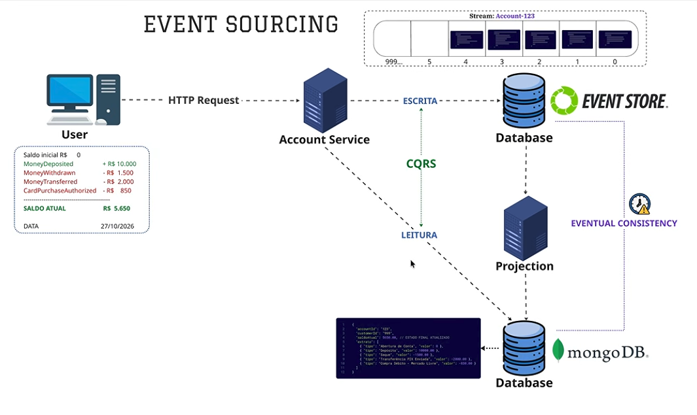

# Event Sourcing Sample (KurrentDB + MongoDB + .NET 11)



> **Regra de ouro:** Para validar regras de negócio, o serviço consulta a **fonte da verdade (KurrentDB / EventStoreDB)** antes de tomar a decisão, evitando aplicar regras com base em dados desatualizados decorrentes da consistência eventual do banco de leitura.

---

## 🏛 Arquitetura do Projeto

1. **`event-sourcing-sample-api` (Command / Escrita & Query / Leitura CQRS)**:
   - **Escrita**: Reconstitui o agregado `TodoAggregate` a partir dos eventos gravados no stream `todo-{id}` no **KurrentDB**. Valida as regras de negócio e adiciona novos eventos atômicos (`TodoCreated`, `TodoUpdated`, `TodoCompleted`, `TodoDeleted`).
   - **Leitura**: Consulta o banco de leitura desnormalizado no **MongoDB** para operações de busca rápida.
   - **Stream Inspection**: Endpoint para inspecionar os eventos brutos direto do KurrentDB.

2. **`event-sourcing-sample-projection` (Worker / Projeção)**:
   - Mantém uma subscrição contínua (Catch-up Subscription com `SubscribeToAll`) aos eventos do KurrentDB.
   - Atualiza a coleção `todos` no **MongoDB** conforme os eventos chegam.
   - Salva a posição atual (`CommitPosition` / `PreparePosition`) na coleção `checkpoints` do MongoDB para garantir resiliência e continuidade após reinicializações.

3. **`event-sourcing-sample-shared` (Contratos Compartilhados)**:
   - Enums (`TodoStatus`: `Pending`, `InProgress`, `Completed`, `Cancelled`).
   - Eventos de Domínio (`TodoCreated`, `TodoUpdated`, `TodoCompleted`, `TodoDeleted`).
   - Modelos de Leitura (`TodoReadModel`) e Checkpoint (`ProjectionCheckpoint`).

---

## 🚀 Como Executar

### 1. Subir os Bancos de Dados com Docker
Execute na raiz da solução:
```bash
docker compose up -d
```
Serviços disponíveis:
- **KurrentDB / EventStoreDB UI**: [http://localhost:2113](http://localhost:2113)
- **MongoDB**: `localhost:27017`
- **Mongo Express (UI do Mongo)**: [http://localhost:8081](http://localhost:8081)

### 2. Iniciar a API
```bash
dotnet run --project event-sourcing-sample-api
```
Acesse a documentação OpenAPI em: [http://localhost:5171/openapi/v1.json](http://localhost:5171/openapi/v1.json)

### 3. Iniciar o Serviço de Projeção
Em outro terminal:
```bash
dotnet run --project event-sourcing-sample-projection
```

---

## 📬 Endpoints da API

| Método | Rota | Descrição |
|---|---|---|
| `POST` | `/todos` | Cria um Todo e grava `TodoCreated` no KurrentDB |
| `PUT` | `/todos/{id}` | Altera a descrição e o status e grava `TodoUpdated` |
| `PATCH` | `/todos/{id}/complete` | Marca como concluído (`isDone = true`) e grava `TodoCompleted` |
| `PUT` | `/todos/{id}/complete` | Rota alternativa para conclusão do Todo |
| `DELETE` | `/todos/{id}` | Exclui logicamente (`isDeleted = true`) e grava `TodoDeleted` |
| `GET` | `/todos` | Retorna os Todos gravados no MongoDB (suporta `?includeDeleted=true`) |
| `GET` | `/todos/{id}` | Retorna um Todo por Id direto do MongoDB |
| `GET` | `/todos/{id}/events` | Retorna o histórico de eventos brutos direto do KurrentDB |

Você também pode testar as requisições utilizando o arquivo [event-sourcing-sample-api.http](file:///home/ev3r/Projects/event-sourcing-sample/event-sourcing-sample-api/event-sourcing-sample-api.http).
